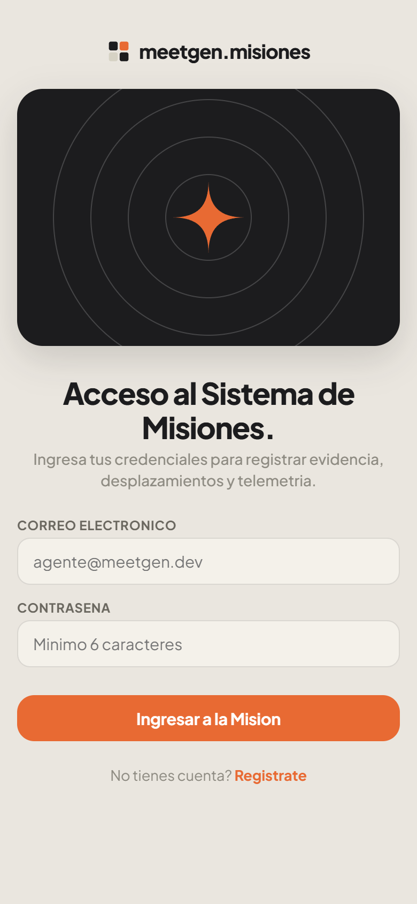
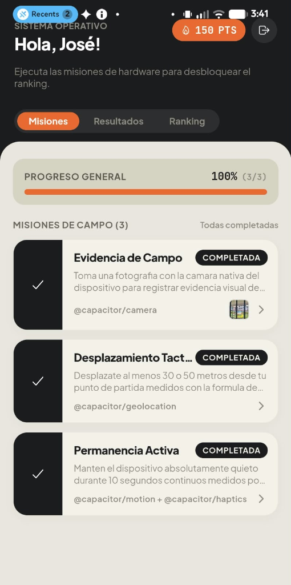
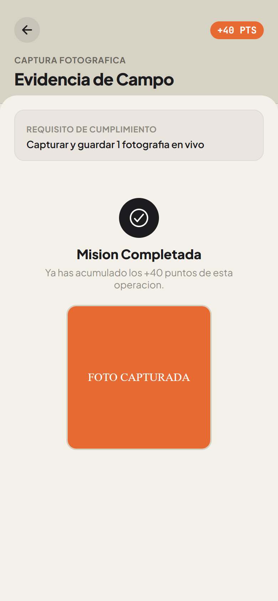
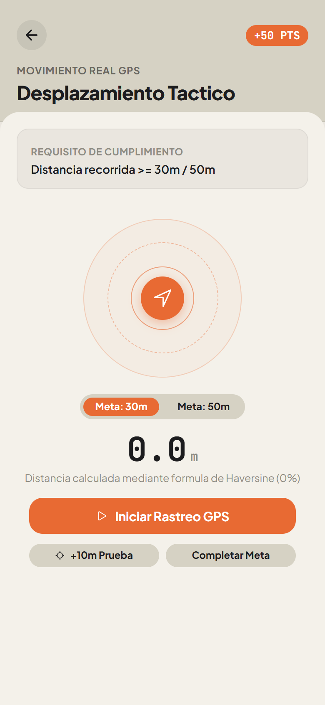
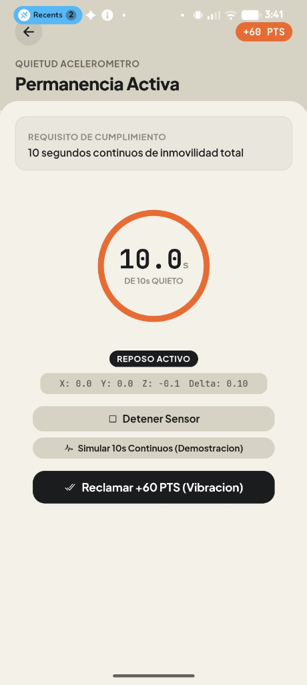
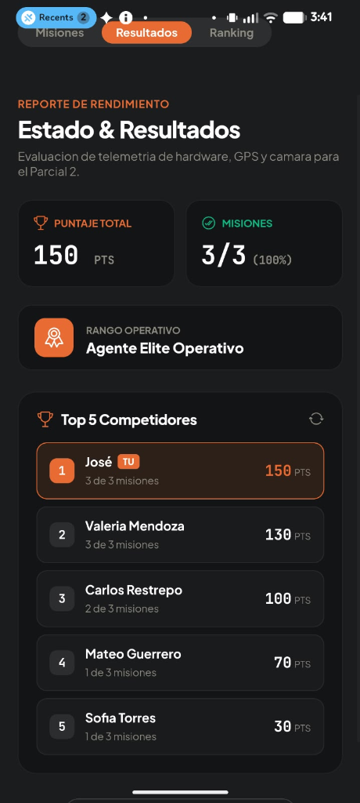
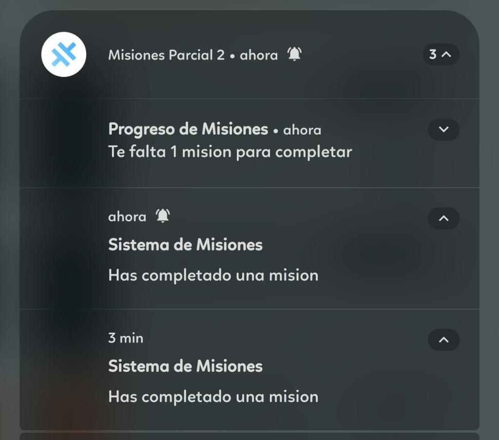

# Parcial 2 - Sistema de Misiones Reales con Sensores, Puntos y Ranking

Sistema integral de ejecucion de misiones tacticas de hardware desarrollado con Ionic React, TypeScript, Capacitor y Firebase Auth / Firestore. La aplicacion implementa una identidad visual editorial inspirada en el diseno de referencia Meetgen, basada en una paleta cromatica calida, tipografia editorial y monoespaciada, micro-interacciones tactiles y persistencia dual sincronizada en tiempo real.

---

## 1. Galeria Visual y Evidencias de Ejecucion en Dispositivo Real

A continuacion se presenta la galeria organizada con las evidencias de ejecucion y pruebas reales en dispositivo fisico Android, complementadas con el flujo de navegacion editorial Meetgen:

| 01. Acceso y Registro Editorial | 02. Dashboard en Dispositivo Fisico (150 PTS) |
| :---: | :---: |
|  |  |

| 03. Mision 1: Evidencia (Camara Nativa) | 04. Mision 2: Desplazamiento (Radar GPS) |
| :---: | :---: |
|  |  |

| 05. Mision 3: Permanencia (10.0s Quietud) | 06. Resultados y Ranking Top 5 (Liderazgo) |
| :---: | :---: |
|  |  |

### Notificaciones Locales Nativas en Dispositivo Fisico
Validacion de notificaciones del sistema disparadas en tiempo real mediante `@capacitor/local-notifications` al completar misiones y al alcanzar 2 de 3 misiones cumplidas:

<div align="center">
  
</div>

---

## 2. Arquitectura de Software y Custom Hooks

La logica de negocio y el acceso a los sensores del dispositivo se encuentran desacoplados de la capa de presentacion a traves de una arquitectura basada en Custom Hooks en `src/hooks/`:

### useMissions (`src/hooks/useMissions.ts`)
Hook central orquestador de estado que:
- Administra el puntaje acumulado y el arreglo de misiones.
- Lee inmediatamente el cache de persistencia local para asegurar renderizado instantaneo sin bloqueo de red.
- Sincroniza bidireccionalmente el progreso tanto en `localStorage` como en Cloud Firestore (`users/{uid}`).
- Aplica las reglas de desbloqueo secuencial (la Mision 3 permanece bloqueada hasta que la Mision 2 es completada).
- Evalua el cumplimiento de metas y dispara las notificaciones locales correspondientes.

### useCamera (`src/hooks/useCamera.ts`)
- Encapsula `@capacitor/camera` ejecutando `Camera.getPhoto` con `resultType: CameraResultType.DataUrl` y `source: CameraSource.Camera`.
- Almacena y retorna la fotografia en base64 para previsualizacion inmediata en miniatura dentro de la tarjeta de la mision.

### useGeolocation (`src/hooks/useGeolocation.ts`)
- Encapsula `@capacitor/geolocation` invocando `Geolocation.watchPosition` con `enableHighAccuracy: true`.
- Fija las coordenadas de origen al iniciar el rastreo tactico y calcula en tiempo real la distancia euclidiana geodesica mediante la formula del Semiverseno (Haversine).
- Expone un selector de umbral configurable (`30m / 50m`) para pruebas tanto en exteriores como en espacios controlados.

### useAccelerometer (`src/hooks/useAccelerometer.ts`)
- Encapsula `@capacitor/motion` suscribiendose a `Motion.addListener('accel', ...)`.
- Mide la aceleracion instantanea en los tres ejes espaciales (X, Y, Z) y calcula el delta de movimiento absoluto.
- Si el delta supera el umbral de tolerancia (`> 1.2 m/s^2`), el cronometro de quietud se reinicia a `0.0s` y notifica visualmente con un efecto de agitacion (*shake*).
- Si el dispositivo se mantiene estable durante 10.0 segundos continuos, ejecuta la vibracion haptica y finaliza la mision con exito.

### useHaptics (`src/hooks/useHaptics.ts`)
- Encapsula `@capacitor/haptics` ejecutando `Haptics.vibrate({ duration: 500 })` para confirmacion fisica al completar la prueba de inmovilidad.

### useLocalNotifications (`src/hooks/useLocalNotifications.ts`)
- Encapsula `@capacitor/local-notifications` solicitando permisos nativos y programando alertas locales inmediatas segun los requerimientos exactos:
  - Al completar cualquier mision: `"Has completado una misión"`
  - Al alcanzar 2 de 3 misiones completadas: `"Te falta 1 misión para completar"`

---

## 3. Logica de las Misiones de Hardware

```
   +-----------------------------------------------------------+
   |                     SISTEMA DE MISIONES                   |
   +-----------------------------------------------------------+
                                 |
         +-----------------------+-----------------------+
         |                                               |
         v                                               v
   [Mision 1: Camara]                           [Mision 2: Geolocation]
   Puntos: +40 PTS                              Puntos: +50 PTS
   Capacitor Camera API                         Haversine watchPosition
   Captura de fotografia real                   Meta: 30m o 50m
         |                                               |
         |                                               v
         |                                       [Mision 2 COMPLETADA]
         |                                               |
         |                               (Desbloquea Mision 3)
         |                                               |
         |                                               v
         |                                      [Mision 3: Acelerometro]
         |                                      Puntos: +60 PTS
         |                                      Capacitor Motion API
         |                                      10.0s quietud continua
         |                                      Vibracion Capacitor Haptics
         |                                               |
         +-----------------------+-----------------------+
                                 |
                                 v
                     [Persistencia Dual y Ranking]
                     localStorage + Cloud Firestore
                     Ranking Top 5 con competidores reales
```

### Formula de Haversine para Distancia en Metros
Para calcular el desplazamiento real entre la coordenada inicial $(lat_1, lng_1)$ y la posicion actual $(lat_2, lng_2)$, se utiliza la formula del Semiverseno considerando un radio terrestre medio $R = 6,371,000$ metros:

$$\Delta lat = (lat_2 - lat_1) \cdot \frac{\pi}{180}$$
$$\Delta lng = (lng_2 - lng_1) \cdot \frac{\pi}{180}$$
$$a = \sin^2\left(\frac{\Delta lat}{2}\right) + \cos(lat_1 \cdot \frac{\pi}{180}) \cdot \cos(lat_2 \cdot \frac{\pi}{180}) \cdot \sin^2\left(\frac{\Delta lng}{2}\right)$$
$$c = 2 \cdot \text{atan2}(\sqrt{a}, \sqrt{1 - a})$$
$$distancia = R \cdot c$$

---

## 4. Estructura JSON de Persistencia Dual

El progreso del usuario se almacena de forma sincronizada respetando estrictamente el esquema JSON definido para la evaluacion:

```json
{
  "points": 90,
  "missions": [
    {
      "id": 1,
      "completed": true,
      "evidence": "data:image/jpeg;base64,..."
    },
    {
      "id": 2,
      "completed": true
    },
    {
      "id": 3,
      "completed": false
    }
  ]
}
```

Adicionalmente, en Cloud Firestore dentro del documento `users/{uid}` se sincronizan los atributos `displayName`, `email`, `points` y `updatedAt` para alimentar el sistema de clasificacion en tiempo real.

---

## 5. Instrucciones de Instalacion y Ejecucion

### Requisitos Previos
- Node.js version 18 o superior.
- Java Development Kit (JDK) 17 u 21 configurado en variables de entorno (`JAVA_HOME`).
- Android SDK Platform 34 o 35 instalado con Android Studio / command-line tools.

### Instalacion de Dependencias
```bash
cd parcial-02
npm install
```

### Ejecucion en Servidor de Desarrollo
```bash
npm run dev
```

### Generacion Automatizada de Capturas de Pantalla
El proyecto incluye un script con Playwright que arranca un servidor Vite en segundo plano, inyecta los estados de sesion y misiones, y captura las 6 vistas en alta densidad:
```bash
npm run screenshots
```
Las capturas se guardan automaticamente en `parcial-02/docs/screenshots/`.

---

## 6. Compilacion del APK en Android

1. **Compilar el bundle web de produccion:**
   ```bash
   npm run build
   ```

2. **Sincronizar el proyecto nativo de Capacitor:**
   ```bash
   npx cap sync android
   ```

3. **Compilar el archivo APK de depuracion:**
   ```bash
   cd android
   ./gradlew assembleDebug
   ```

El archivo APK resultante se genera en:
`parcial-02/android/app/build/outputs/apk/debug/app-debug.apk`

Y se encuentra copiado en la raiz del proyecto para su instalacion directa:
`parcial-02/parcial-02-debug.apk`
